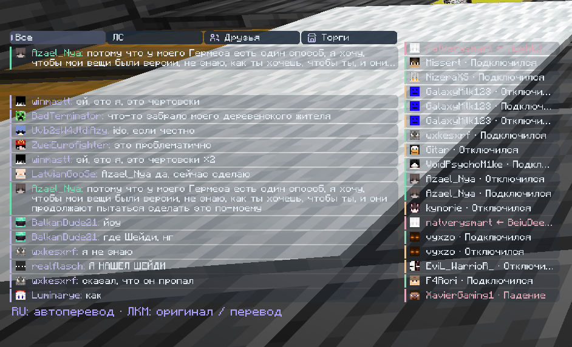
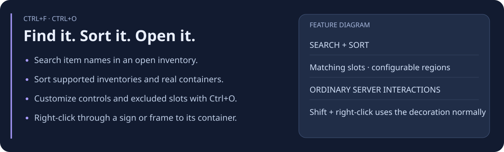
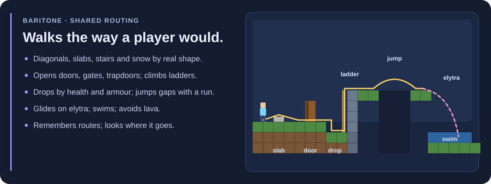
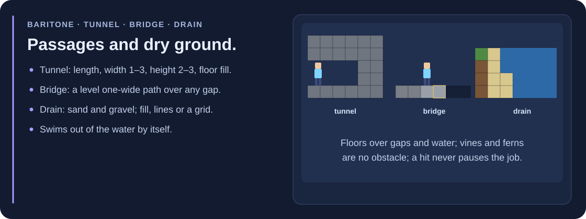
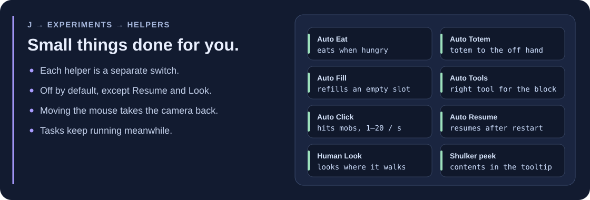

# DraimHorizons

[Download the latest release](https://github.com/DraimCiDo/DraimHorizon/releases/latest) · [Changelog](CHANGELOG.md) · [Relay setup](relay/README.md) · [Navigation](docs/navigation.md) · [Tunnels and bridges](docs/construction.md) · [Farming and schematics](docs/automation.md)

**Install** — Take the files from a release, not from the repository source tree.

- **Sunrise** (Sunrise Launcher 1.0.1 or newer): **Mods → Add from GitHub** with the release link, for example `https://github.com/DraimCiDo/DraimHorizon/releases/tag/v0.41.5` (or `sunrise-launcher mods add-github <release link> --trust-native-code`), then rebuild native mods. The launcher installs the release's `draimhorizons-<version>.smod`.
- **Horizon** (Horizon Launcher 0.2.70 or newer): install the release's `draimhorizons-<version>.hmod`, then rebuild native mods. The launcher builds it against the Mod SDK that Horizon publishes with each Nightly. The old `.hnmod` is no longer produced: those launchers refuse it.

Target clients are the official Horizon Nightly `6d765e0` and Sunrise Nightly `2d81263`, both Java 26.3. Press **J** in game for the mod menu.

**Upgrading from before 0.25.0:** remove `claim_borders` in the launcher, install this repository again, then rebuild native mods. The new entry is `draimhorizon`. Keep the existing data folder; settings, waypoints and history reuse it. Reapply custom key bindings if needed. Do not keep both mod IDs installed.

## Clients

| Client | Status | Pinned official Nightly | How it is checked |
| --- | --- | --- | --- |
| Horizon | Supported. Install the release's `.hmod`. | `6d765e0` (`horizon_revision`) | On every push to `main` and before each release: the `.hmod` is validated against the SDK of that Nightly (`DRAIM_TARGET=horizon python tools/sunrise.py smod-check --fetch`), and the bundle is applied to that exact source and the real client compiles. |
| Sunrise | Supported (new). Install the release's `.smod`. | `2d81263` (`sunrise.revision`) | Each release's `.smod` is validated against the SDK of that Nightly (`python tools/sunrise.py smod-check --fetch`); before release it is built by the Sunrise launcher and checked in game. |

Both pins live in `compatibility.json`. CI compares them every day with the Nightly tag each project publishes
(`python tools/compatibility.py --strict-sunrise`); a newer Nightly turns the check red until the pin is refreshed
and the client is compiled again. On Sunrise the mod keeps its own data folder (settings, waypoints and explored
map start empty), its key labels and Options text are English, and the settings entry in Options → Mods is a
switch that opens the menu. See [platforms/sunrise](platforms/sunrise/README.md).

On Sunrise the `.smod` also lets the client through playhorizon.dev's client check, which currently admits only
Horizon (the server reads the `minecraft:brand` sent during login). When the server announces itself as Horizon,
the mod sends a second brand, `horizon`, before the login continues; every other server sees Sunrise unchanged.
This is experimental: it compiles against the Sunrise SDK but has not yet been confirmed on the live server, and
Horizon-specific server channels (block registry check, mod list) may still differ. See
[platforms/sunrise/smp-compat](platforms/sunrise/smp-compat/README.md).

## World

## Chat and people

Real in-game chat examples, with normal and compact spacing. Sample player text keeps its original language.

**Patting** — Aim at a player within 3 blocks and press **K** (rebindable under Options → Mods → Settings) for two gentle pats. Your own arm moves at once. A player running DraimHorizon on the same relay sees your arm move too, plus an optional "*name* patted you" line. **J → Settings → General** sets who may pat you (friends only by default, everyone or nobody) and turns that line on or off. Patting is cosmetic only: it sends no attack, item use or chat. Players without the mod see nothing.

**Friends keep their place** — If a friend's relay key changes (reinstall, new PC, reset data folder) the mod re-pins the new key automatically when the relay shows a single identity for that account, the old key is gone and the same nickname is on the game server's player list. You get a chat notice; remove the friend if it was unexpected. A friend who lost the friendship is invited once and only has to accept. Ambiguous cases are left untouched and shown as "Key changed".

**Show invisible entities** — After accepting experimental features, enable **J → QOL → Survival → Show invisible entities** to see invisible players and mobs locally. Off by default. This can violate server rules and lead to a ban; experimental consent does not grant server permission. Models use normal depth testing and view range, not a through-wall overlay. Potion timers, server gameplay and other players' views do not change; the client cannot reveal entities the server does not send. Invisible armour stands and item frames are left alone.

## Items and trading

## Baritone

Every Baritone job shares one route planner. A task waits instead of stopping when it has nothing to do, keeps running when you take damage, and resumes after a restart when Auto Resume is on.

## QOL and interface

**Auto Eat** — Open **J → QOL → Survival → Allowed foods** and select food-item tiles, just like mining targets. Only selected foods may be eaten; the list starts empty. Auto Eat waits until a food's entire hunger value fits (steak restores 8 points, so it waits until hunger is 12/20 or lower). Smaller selected snacks can be eaten sooner. Saturation does not affect this check; risky and reserved foods remain excluded.

**Shared DeepL** — Add `RELAY_DEEPL_API_KEY` to the private relay's server environment. Friends configure its address and access token under **J → Settings → Network**. [Operator instructions](relay/README.md#общий-резервный-перевод-deepl)

**Compatibility** — Friends' telemetry requires the relay and both clients to use the mod. Seed Map predicts generation and can differ from modified or previously generated terrain. Baritone acts only through normal client input; the server stays the authority and can refuse any action. Player-supplied text remains unchanged by interface localization.
