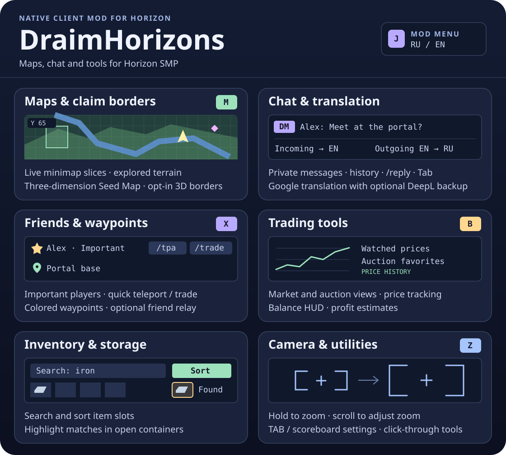
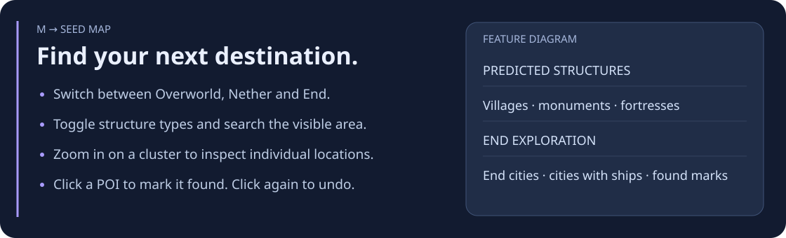
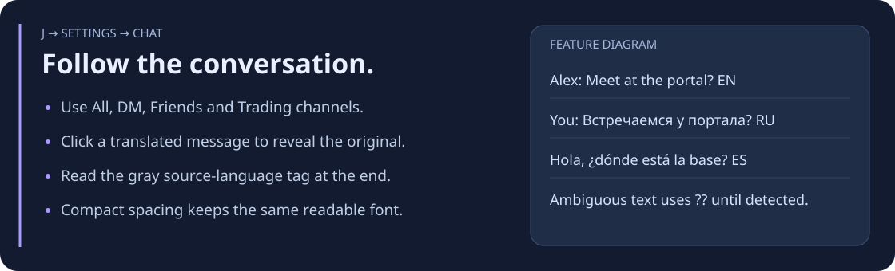
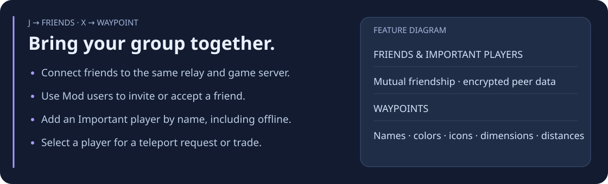
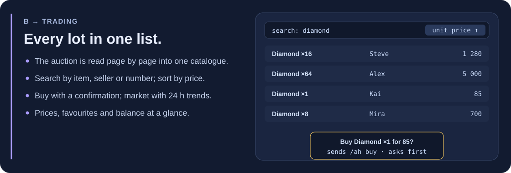
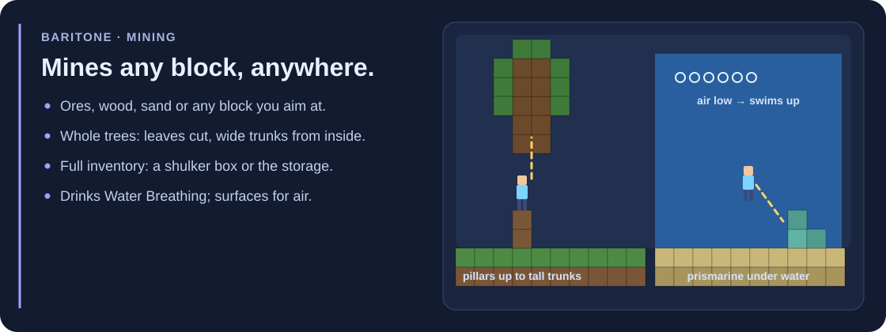
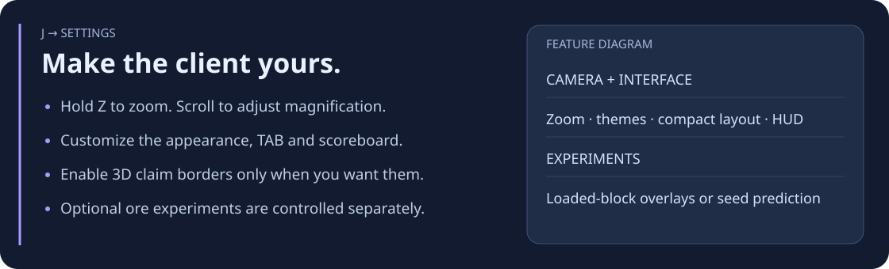

# DraimHorizons

[Download the latest release](https://github.com/DraimCiDo/DraimHorizon/releases/latest) · [Changelog](CHANGELOG.md) · [Relay setup](relay/README.md) · [Navigation](docs/navigation.md) · [Tunnels and bridges](docs/construction.md) · [Farming and schematics](docs/automation.md)

**Install** — Take the files from a release, not from the repository source tree. Each release carries one package per client, built from the same source: `draimhorizons-<version>.hmod` for Horizon and `draimhorizons-<version>.smod` for Sunrise.

| Client | Launcher | Install |
| --- | --- | --- |
| **Horizon** | Horizon Launcher 0.2.70 or newer | **Mods → Add from GitHub** with the release link, or `horizon-launcher mods add-github <release link> --trust-native-code`. Then rebuild native mods (`horizon-launcher native-build`): the launcher builds the mod against the Mod SDK that Horizon publishes with each Nightly. |
| **Sunrise** | Sunrise Launcher 1.0.1 or newer | `sunrise-launcher mods add-github <release link> --trust-native-code`, or **Mods → Add from GitHub** where your launcher has it, or the **Discover** tab if the mod is listed there. Then rebuild native mods. |

A release link looks like `https://github.com/DraimCiDo/DraimHorizon/releases/tag/v0.42.2`. The old `.hnmod` is no longer produced: current launchers refuse it.

**Sunrise, a file you copied in by hand.** Put `draimhorizons-<version>.smod` in the game folder's `sunrise-native-mods/` and add the line `mod.draimhorizon:true` to `sunrise-mods.txt`, beside `options.txt`, then restart. Until then the game's Options → Mods says "Not loaded: turn it on in the launcher". The launcher's own toggle stays locked for hand-copied files because it cannot check where they came from; a mod installed with `mods add-github` or from Discover has a working toggle. To turn a hand-copied mod off, remove that line or the file.

Target clients are the official Horizon Nightly `f1bb66f` and the Sunrise Dev build `ba1f24e`, both Java 26.3. A native mod is built for exactly one game build, so after a client update install the release made for it (the release notes name the build). Press **J** in game for the mod menu.

**Upgrading from before 0.25.0:** remove `claim_borders` in the launcher, install this repository again, then rebuild native mods. The new entry is `draimhorizon`. Keep the existing data folder; settings, waypoints and history reuse it. Reapply custom key bindings if needed. Do not keep both mod IDs installed.

## Clients

| Client | Status | Pinned official Nightly | How it is checked |
| --- | --- | --- | --- |
| Horizon | Checks and new `.hmod` releases are temporarily paused while horizon-rust is unavailable. Previous releases remain available. | `f1bb66f` (`horizon_revision`) | SDK validation and source staging will resume after upstream recovery. |
| Sunrise | Supported. Install the release's `.smod`. | Dev build `ba1f24e` (`sunrise.revision`), until a Nightly as new is published | SDK validation uses `python tools/sunrise.py smod-check --fetch` and remains required before release. Source staging needs a local horizon-mixins checkout while horizon-rust/horizon-mixins is unavailable. |

Both pins live in `compatibility.json`. During the horizon-rust outage, CI checks only Sunrise every day
(`python tools/compatibility.py --sunrise-only --strict-sunrise`). Releases contain only `.smod` and its SHA-256
checksum. Restore the paused workflow jobs, Horizon release assets and native publication gate, and remove
`--sunrise-only` from CI commands after upstream recovery. A newer Nightly turns the check red until the pin
is refreshed and validated. Nightlies come often, so a release can be one Nightly behind for a short time.
The Sunrise pin may instead be a published Dev build (`"channel": "dev"`) while it is newer than the published Nightly,
when the port needs something no Nightly has yet; the check turns red once a Nightly as new is published.

**Not available on Horizon yet.**
- The third-person patting arm (see Patting below): other players do not see your arm move. Your own view and the
  rest of patting work as described. Horizon's own `BodyPose` hook is the intended route.

**On Sunrise** the mod keeps its own data folder (settings, waypoints and explored map start empty), its key labels and
Options text are English, and the settings entry in Options → Mods is a switch that opens the menu. See [platforms/sunrise](platforms/sunrise/README.md).

Sunrise's own `sunrise-official` layer handles client identity for the official Horizon SMP. The
Sunrise version of DraimHorizon uses the same map controls and markers with Sunrise's own dynamic
texture interface. See
[platforms/sunrise/smp-compat](platforms/sunrise/smp-compat/README.md).

**Building from source.** The mod is written once in `mixins/draimhorizon`; `tools/sunrise.py` derives each client's
project from it and `platforms/<client>` (`python tools/package_flat.py horizon|sunrise`). See
[docs/development.md](docs/development.md) for the checks.

## World

## Chat and people

Real in-game chat examples, with normal and compact spacing. Sample player text keeps its original language.

**Patting** — Aim at a player within 3 blocks and press **K** (rebindable under Options → Mods → Settings) for two gentle pats. Your own arm moves at once. A player running DraimHorizon on the same relay sees your arm move too (Sunrise; not yet on Horizon), plus an optional "*name* patted you" line. **J → Settings → General** sets who may pat you (friends only by default, everyone or nobody) and turns that line on or off. Patting is cosmetic only: it sends no attack, item use or chat. Players without the mod see nothing.

**Friends keep their place** — If a friend's relay key changes (reinstall, new PC, reset data folder) the mod re-pins the new key automatically when the relay shows a single identity for that account, the old key is gone and the same nickname is on the game server's player list. You get a chat notice; remove the friend if it was unexpected. A friend who lost the friendship is invited once and only has to accept. Ambiguous cases are left untouched and shown as "Key changed".

**Important players** — **J → Friends → Important** adds a player by exact name, offline included, and gives them a colour. Press the colour chip beside the **Colour** field for a full picker: a saturation/brightness square, a hue bar, a live `#RRGGBB` readout and a preview, plus eight presets and Done / Cancel [Esc]. Dragging previews the colour and **Done** stores it; a saved player is recoloured then, while a new name keeps the colour until **Save**. You can also click one of the eight swatches or type a `#RRGGBB` value, and the colour paints that player's name in chat while their messages stay visible with global chat off. Friends are always important and need no rule.

**Show invisible entities** — After accepting experimental features, enable **J → QOL → Survival → Show invisible entities** to see invisible players and mobs locally. Off by default. This can violate server rules and lead to a ban; experimental consent does not grant server permission. Models use normal depth testing and view range, not a through-wall overlay. Potion timers, server gameplay and other players' views do not change; the client cannot reveal entities the server does not send. Invisible armour stands and item frames are left alone.

## Items and trading

## Baritone

Every Baritone job shares one route planner. A task waits instead of stopping when it has nothing to do, keeps running when you take damage, and resumes after a restart when Auto Resume is on.

**Storage sorter** — Open **J → Experimental → Automation → Sorting**. Like a copper golem, it takes items from an input container and carries each one to the container meant for it:

1. A container with an item frame showing that item. A frame on either half of a double chest labels the whole chest.
2. An unframed container already holding that item when it was last opened.
3. The overflow container, if one is set.
4. With **Empty ones** on, the nearest empty unframed container.

Anything else stays in the input. Mark the storage zone with **Corner 1** and **Corner 2** at its opposite corners (up to 128×128 blocks and 24 levels). Aim at a container and press **Input** (up to four) or **Overflow**. **Sort now** empties the inputs once. **Watch** checks them again every 30 seconds. **Survey** opens every container it has not seen yet, to learn its contents. The same actions are available as `/dsort pos1|pos2|input|overflow|start|watch|survey|stop|empty|status|clear`.

While you are near the storage, the sorter indexes its containers and the item frames within 24 blocks and saves them per world. A large storage therefore does not need reopening each round. Only items taken from an input are carried off; items already in your inventory stay there. Full containers are skipped, and items with nowhere to go are returned to the input.

## QOL and interface

**Auto Eat** — Open **J → QOL → Survival → Allowed foods** and select food-item tiles, just like mining targets. Only selected foods may be eaten; the list starts empty. Auto Eat waits until a food's entire hunger value fits (steak restores 8 points, so it waits until hunger is 12/20 or lower). Smaller selected snacks can be eaten sooner. Saturation does not affect this check; risky and reserved foods remain excluded.

**Shared DeepL** — Add `RELAY_DEEPL_API_KEY` to the private relay's server environment. Friends configure its address and access token under **J → Settings → Network**. [Operator instructions](relay/README.md#общий-резервный-перевод-deepl)

**Compatibility** — Friends' telemetry requires the relay and both clients to use the mod. Seed Map predicts generation and can differ from modified or previously generated terrain. Baritone acts only through normal client input; the server stays the authority and can refuse any action. Player-supplied text remains unchanged by interface localization.
