# DraimHorizons

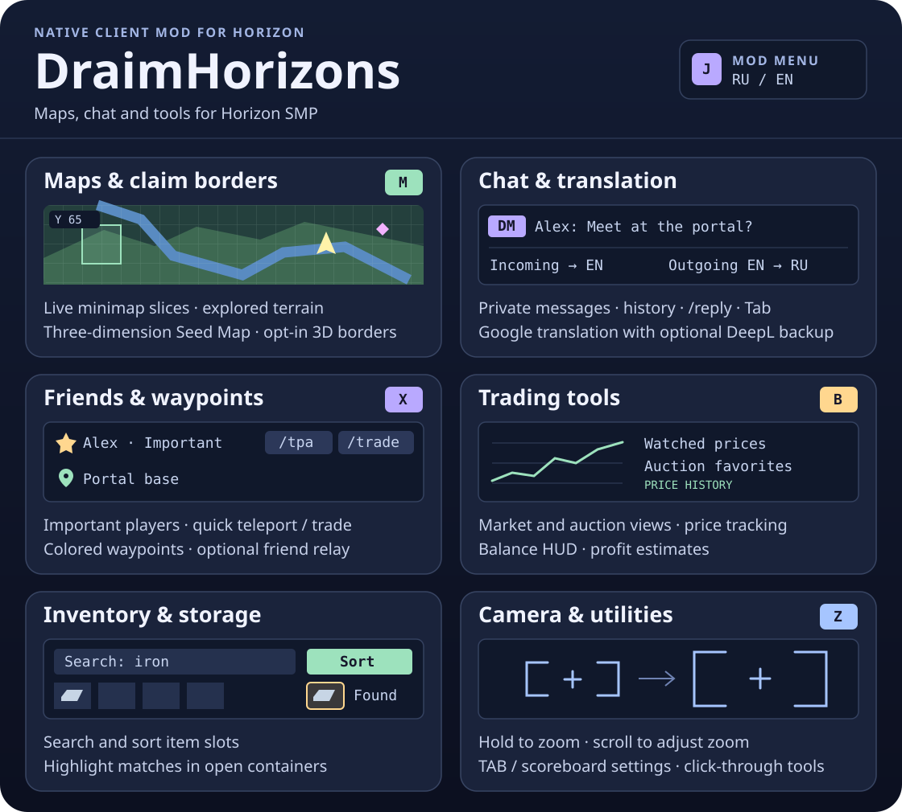

[Download the latest release](https://github.com/DraimCiDo/DraimHorizon/releases/latest) · [Changelog](CHANGELOG.md) · [Relay setup](relay/README.md) · [Navigation](docs/navigation.md) · [Tunnels and bridges](docs/construction.md) · [Farming and schematics](docs/automation.md)

**Install** — In Horizon Launcher, choose **Install from GitHub**, enter `https://github.com/DraimCiDo/DraimHorizon`, then rebuild native mods. Target client is the official Horizon Nightly `fdc87ae` for Java 26.3. Press **J** in game for the mod menu.

**Upgrading from before 0.25.0:** remove `claim_borders` in the launcher, install this repository again, then rebuild native mods. The new entry is `draimhorizon`. Keep the existing data folder; settings, waypoints and history reuse it. Reapply custom key bindings if needed. Do not keep both mod IDs installed.

## World

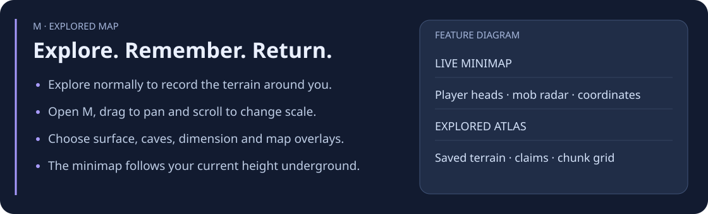
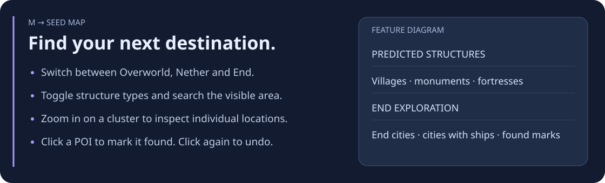

## Chat and people

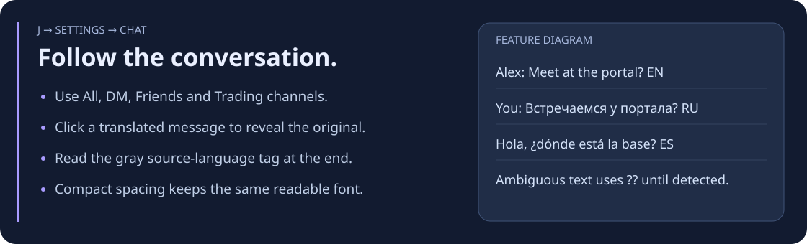

Real in-game chat examples, with normal and compact spacing. Sample player text keeps its original language.

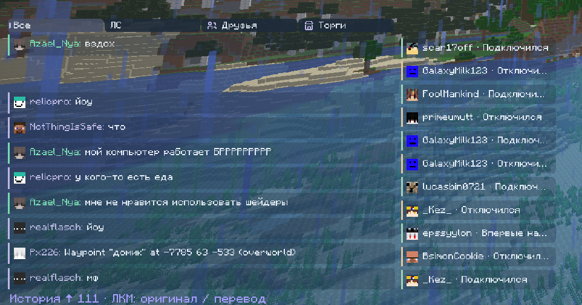
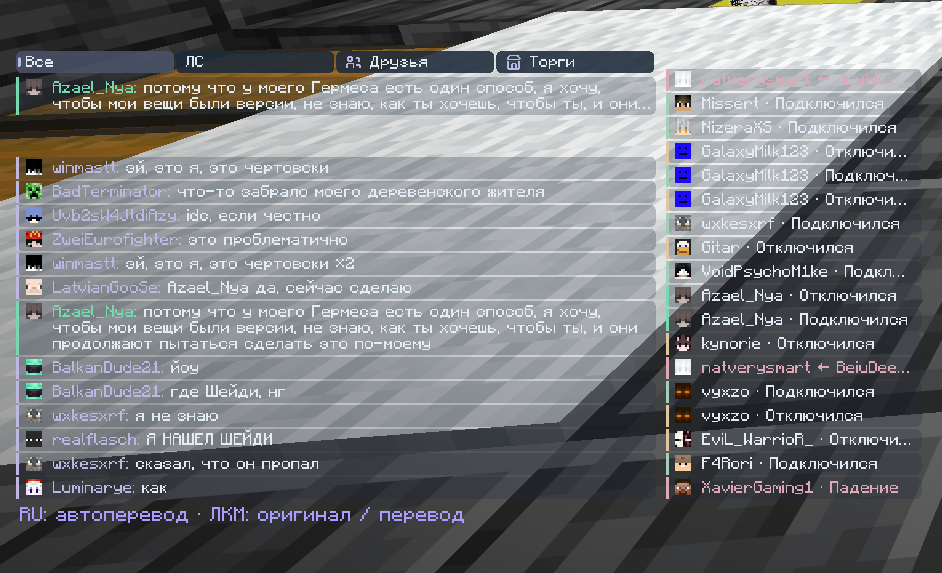

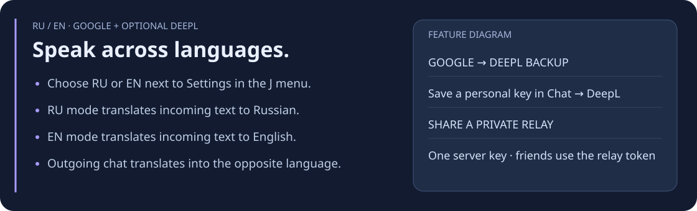
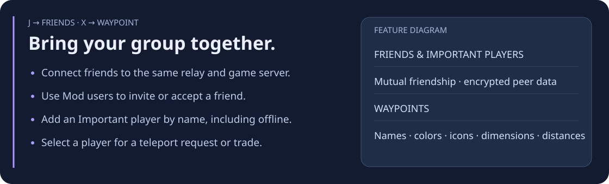

**Patting** — Aim at a player within 3 blocks and press **K** (rebindable under Options → Mods → Settings) for two gentle pats. Your own arm moves at once. A player running DraimHorizon on the same relay sees your arm move too, plus an optional "*name* patted you" line. **J → Settings → General** sets who may pat you (friends only by default, everyone or nobody) and turns that line on or off. Patting is cosmetic only: it sends no attack, item use or chat. Players without the mod see nothing.

**Show invisible entities** — Enable **J → Settings → General → Show invisible entities** to see invisible players and mobs locally. Off by default. Models use normal depth testing and view range, not a through-wall overlay. Potion timers, server gameplay and other players' views do not change; the client cannot reveal entities the server does not send. Invisible armour stands and item frames are left alone.

## Items and trading

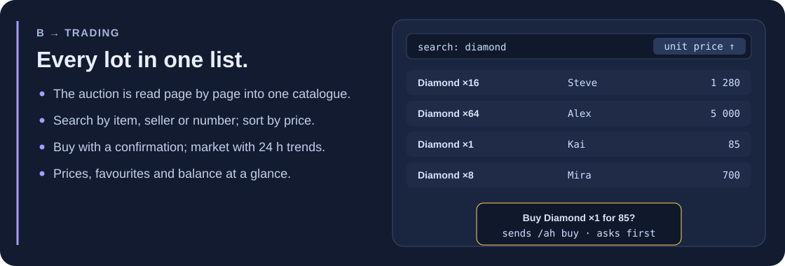
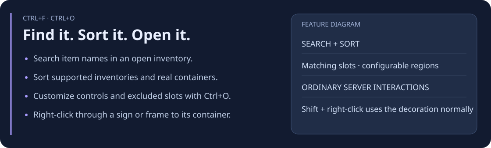

## Baritone

Every Baritone job shares one route planner. A task waits instead of stopping when it has nothing to do, keeps running when you take damage, and resumes after a restart when Auto Resume is on.

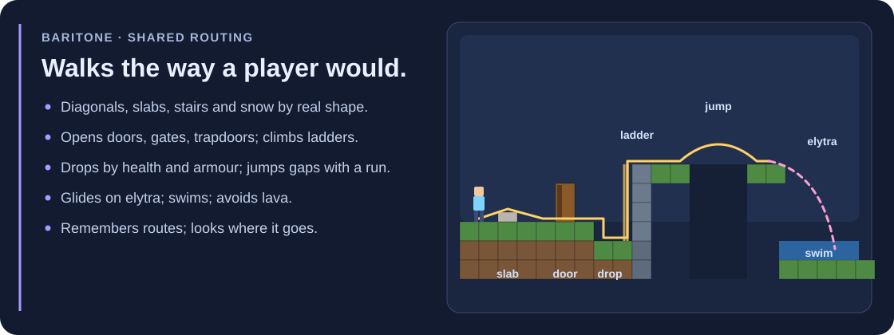
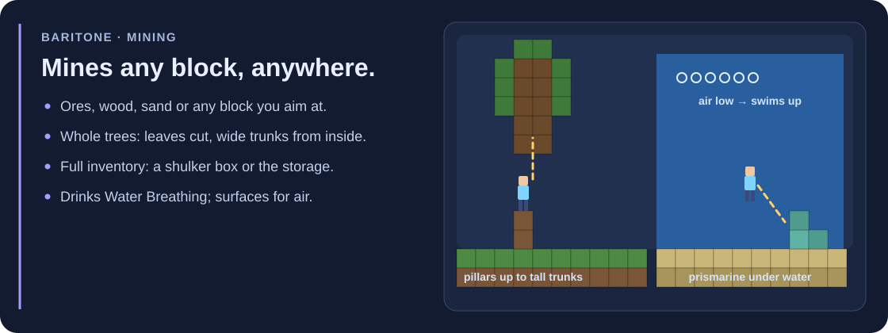
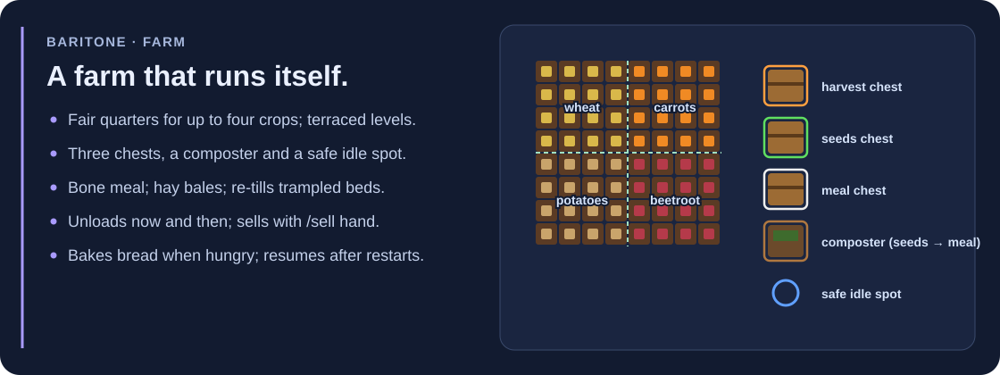
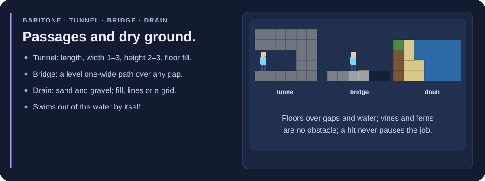
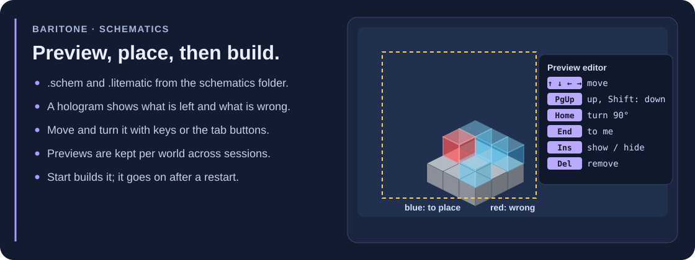

## Helpers and interface

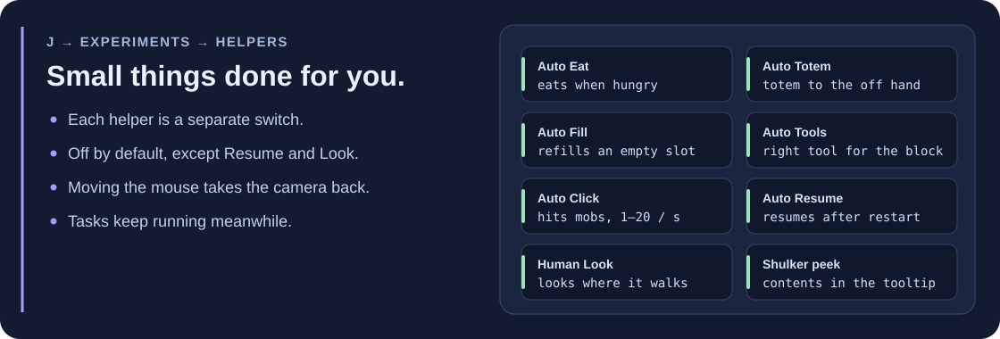
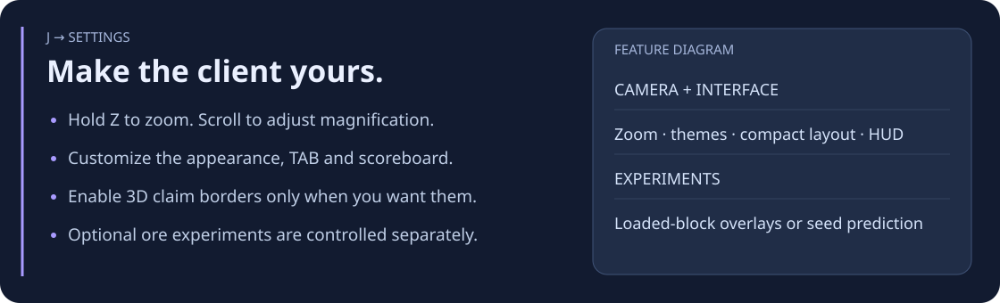

**Shared DeepL** — Add `RELAY_DEEPL_API_KEY` to the private relay's server environment. Friends configure its address and access token under **J → Settings → Network**. [Operator instructions](relay/README.md#общий-резервный-перевод-deepl)

**Compatibility** — Friends' telemetry requires the relay and both clients to use the mod. Seed Map predicts generation and can differ from modified or previously generated terrain. Baritone acts only through normal client input; the server stays the authority and can refuse any action. Player-supplied text remains unchanged by interface localization.
